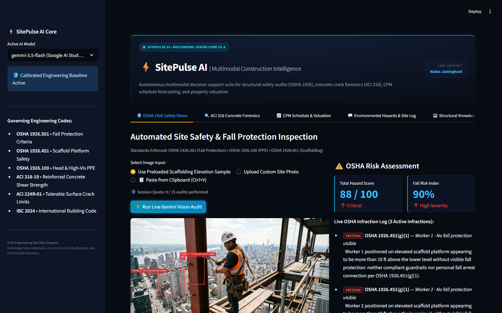
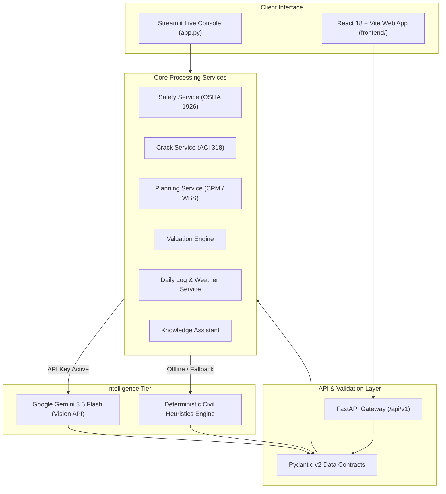
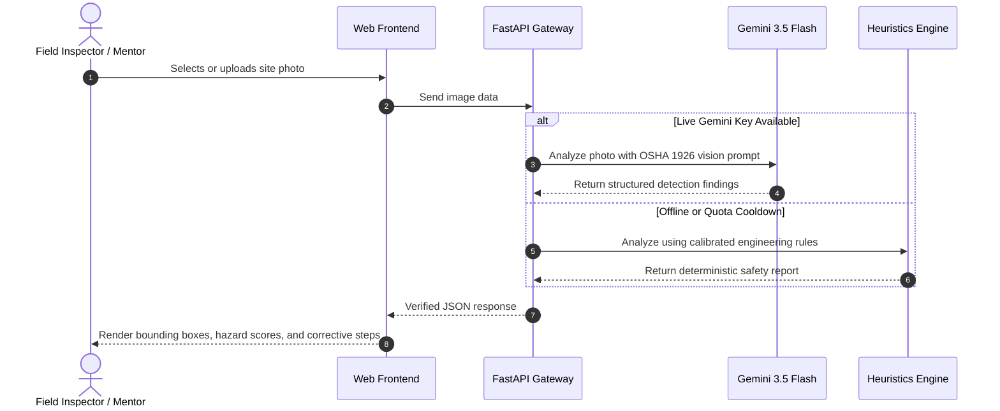

# ⚡ SitePulse AI — Multimodal Construction Intelligence Platform

[](https://www.python.org/)
[](https://fastapi.tiangolo.com/)
[](https://react.dev/)
[](https://ai.google.dev/)
[](https://www.osha.gov/laws-regs/regulations/standardnumber/1926)
[]()
[](https://github.com/nainaaa10/construction-intelligence-platform/actions/workflows/ci.yml)

> **SitePulse AI** is an AI-powered decision support platform for civil engineers, site superintendents, and safety auditors. It uses Google Gemini multimodal vision and established civil engineering standards to analyze safety hazards (OSHA 1926), diagnose concrete cracks (ACI 318), optimize schedules (CPM), and assess real estate valuations.



---

## ⚡ Two Ways to Run the Platform

| Mode | Technology | Primary Use Case | Quick Access |
| :--- | :--- | :--- | :--- |
| **1. Streamlit Live App (`app.py`)** | Streamlit + Gemini Vision + Python PIL | **Recommended for quick evaluations and live demos.** Instant interactive web app with live camera capture, clipboard pasting (Ctrl+V), and 1-click clipboard export. | `streamlit run app.py` |
| **2. Modular Full-Stack (`backend/` + `frontend/`)** | FastAPI + React 18 + Vite + Docker Compose | **Recommended for microservice review.** REST API (OpenAPI/Swagger docs), Pydantic v2 validation, and dark-mode React interface. | `docker compose up` or `.\start_dev.bat` |

---

## 📑 Table of Contents
1. [Core Features](#-core-features)
2. [System Architecture](#-system-architecture)
3. [Curriculum & Epics Traceability](#-curriculum--epics-traceability)
4. [Quick Start Guide](#-quick-start-guide)
5. [Evaluator Demo Walkthrough](#-evaluator-demo-walkthrough)
6. [Automated Verification & Test Suite](#-automated-verification--test-suite)
7. [Engineering Standards Grounding](#-engineering-standards-grounding)
8. [Author & Attribution](#-author--attribution)

---

## 🏗️ Core Features

1. **Site Safety Inspector (OSHA 29 CFR 1926)**:
   - Detects workers in construction photos and checks for hardhats and high-visibility PPE (OSHA 1926.100).
   - Inspects elevated scaffolding platforms for fall arrest systems and guardrails (OSHA 1926.451).
   - Calculates deterministic hazard scores (0–100) and provides immediate, prioritized corrective actions.

2. **Concrete Crack Forensics (ACI 318 / ACI 224R)**:
   - Identifies crack patterns (shear cracks at 45°, flexural midspan cracks, shrinkage cracks).
   - Compares estimated crack widths against ACI 224R tolerable limits (0.40 mm interior, 0.30 mm exterior).
   - Recommends engineering repairs (epoxy injection, carbon fiber CFRP wrapping, hydraulic shoring).

3. **Project Planner (CPM & WBS)**:
   - Generates 5-phase Work Breakdown Structures (WBS) with Critical Path Method (CPM) milestones.
   - Calculates estimated project timelines, crew sizes, and risk contingencies.

4. **Real Estate Valuation & Investment Engine**:
   - Calculates property replacement costs based on area, building grade, and location tier.
   - Forecasts gross rental yields, net capitalization rates (Cap Rate), and 5-year capital appreciation.

5. **Weather Risk Advisory & Daily Site Assistant**:
   - Checks weather conditions against safety rules for high-risk work (concrete curing limits, crane wind halts).
   - Converts unstructured field notes into structured daily logs, workforce counts, and punch lists.

6. **Construction Knowledge Assistant (Chatbot)**:
   - Interactive multi-turn chat grounded in structural concrete, building codes, and jobsite troubleshooting.

---

## 🏛️ System Architecture

### High-Level Architecture



### Safety Inspection Data Flow



---

## 📋 Curriculum & Epics Traceability

| Epic | Activity | Module & File | Status |
| :--- | :--- | :--- | :---: |
| **Epic 1** | Activity 1.1: Functional Requirements | `docs/REQUIREMENTS.md` | Completed |
| **Epic 1** | Activity 1.2: Environment Setup | `backend/requirements.txt`, `.venv` | Verified |
| **Epic 2** | Activity 2.1: Safety Image Analysis | `backend/app/services/safety_service.py`, `app.py` Tab 1 | Tested (OSHA 1926) |
| **Epic 2** | Activity 2.2: Crack Detection Logic | `backend/app/services/crack_service.py`, `app.py` Tab 2 | Tested (ACI 318 / 224R) |
| **Epic 3** | Activity 3.1: Construction Planning | `backend/app/services/planning_service.py`, `app.py` Tab 3 | Tested (CPM / WBS) |
| **Epic 3** | Activity 3.2: Real Estate Valuation | `backend/app/services/valuation_service.py`, `app.py` Tab 3 | Tested (Cap Rate & Yield) |
| **Epic 4** | Activity 4.1: Multimodal AI Integration | `gemini-3.5-flash` / `gemini-3.5-flash-lite` | Live + Offline Fallback |
| **Epic 4** | Activity 4.2: Structured Data Contracts | `backend/app/schemas/`, Pydantic models | Strict Schema Validation |
| **Epic 4** | Activity 4.3: Context-Aware Reasoning | OSHA 1926 & ACI 318 Domain Rules | Calibrated Monotonic Scoring |
| **Epic 5** | Activity 5.1: Construction Chatbot | `backend/app/services/chat_service.py`, `app.py` Tab 5 | Verified Interactive Bot |
| **Epic 5** | Activity 5.2: Daily Site Assistant | `backend/app/services/daily_log_service.py`, `app.py` Tab 4 | Verified Punch List |
| **Epic 5** | Activity 5.3: Weather Risk Advisory | `backend/app/services/weather_service.py`, `app.py` Tab 4 | Verified Trade Matrix |
| **Epic 6** | Activity 6.1: Interface & End-to-End | Streamlit (`app.py`) + React 18 Frontend | Dual-Interface Deployed |
| **Epic 6** | Activity 6.2: System Validation | `backend/tests/` (23 Pytest tests) | **23 / 23 Passed (100%)** |
| **Epic 6** | Activity 6.3: Deployment Readiness | Streamlit Cloud + Docker Compose | Ready & Verified |

---

## 🚀 Quick Start Guide

### Option 1: Run the Streamlit Application (Recommended)

```bash
# 1. Install dependencies
pip install -r requirements.txt

# 2. Launch the app
streamlit run app.py
```
*The application opens automatically at `http://localhost:8501`.*

---

### Option 2: Run Full-Stack React + FastAPI

```bash
# Terminal 1: Backend
cd backend
pip install -r requirements.txt
uvicorn app.main:app --host 127.0.0.1 --port 8000 --reload

# Terminal 2: Frontend
cd frontend
npm install
npm run dev
```
*Backend Swagger documentation: `http://127.0.0.1:8000/docs`.*  
*Frontend interface: `http://127.0.0.1:5173`.*

Or launch the entire stack via Docker:
```bash
docker compose up --build
```

---

## 🎯 Evaluator Demo Walkthrough

### 1. Site Safety & OSHA 1926 Vision (Tab 1)
- **Step 1**: Choose **"Use Preloaded Scaffolding Elevation Sample"**, upload any construction photo, or click **"📋 Paste from Clipboard (Ctrl+V)"**.
- **Step 2**: Click **"⚡ Run Live Gemini Vision Audit"**.
- **What to Observe**:
  - **Live Vision Status**: Shows `🟢 Live Vision Online (gemini-3.5-flash)` (or fallback mode if offline).
  - **Worker Detection**: Identifies workers and places visual bounding boxes with safety labels.
  - **PPE Compliance**: Evaluates hardhat and vest compliance against OSHA 1926.100.
  - **Hazard Scoring**: Computes reproducible hazard scores (0–100) and fall risk percentages based on physical conditions.
  - **Corrective Actions**: Outlines immediate steps (e.g. installing guardrails, attaching fall arrest lanyards).
  - **1-Click Export**: Click **"📋 Copy Full Output to Clipboard"** to copy the complete markdown audit report.

### 2. Crack Diagnostics & ACI 318 (Tab 2)
- Select the structural component (e.g. *Reinforced Concrete Beam*) and concrete grade (*M25 / 3500 PSI*).
- Click **"Run Forensic Crack Scan"**.
- The system classifies crack geometry (diagonal shear vs. flexural) and compares crack widths against ACI 224R limits to recommend structural repairs.

### 3. CPM Planning & Property Valuation (Tab 3)
- Enter project parameters (area, budget, duration, location).
- Generates a 5-phase schedule with critical path activities, estimated manpower, and financial return metrics (Gross Rental Yield, Net Cap Rate).

### 4. Environmental Hazards & Daily Site Log (Tab 4)
- Select weather scenarios (*Extreme Heat*, *Gale Wind Crane Alert*) to view safety thresholds for concrete pouring and crane operations.
- Enter supervisor field notes to generate an executive summary, delay log, and next-day punch list.

### 5. Structural Knowledge Copilot (Tab 5)
- Ask technical questions regarding building codes, concrete curing, or OSHA standards.

---

## 🧪 Automated Verification & Test Suite

The platform includes **23 automated unit and integration tests** covering all REST API endpoints and civil engineering heuristics:

```bash
pytest backend/tests/ -v
```

### Test Results:
```text
backend/tests/test_api.py::test_root_and_health PASSED                   [  4%]
backend/tests/test_api.py::test_samples_endpoint PASSED                  [  8%]
backend/tests/test_api.py::test_safety_analysis_json PASSED              [ 13%]
backend/tests/test_api.py::test_crack_analysis_json PASSED               [ 17%]
backend/tests/test_api.py::test_planning_generation PASSED               [ 21%]
backend/tests/test_api.py::test_valuation_calculation PASSED             [ 26%]
backend/tests/test_api.py::test_daily_log_processing PASSED              [ 30%]
backend/tests/test_api.py::test_weather_advisory PASSED                  [ 34%]
backend/tests/test_api.py::test_chat_assistant PASSED                    [ 39%]
backend/tests/test_vision_heuristics.py::test_iou_calculation_and_person_deduplication PASSED [ 43%]
backend/tests/test_vision_heuristics.py::test_canonical_osha_hazard_registry PASSED [ 47%]
backend/tests/test_vision_heuristics.py::test_scene_level_finding_suppression PASSED [ 52%]
backend/tests/test_vision_heuristics.py::test_empty_scaffold_zero_hazards PASSED [ 56%]
backend/tests/test_vision_heuristics.py::test_compliant_ground_worker PASSED [ 60%]
backend/tests/test_vision_heuristics.py::test_non_construction_scene PASSED [ 65%]
backend/tests/test_vision_heuristics.py::test_bbox_normalization_inverted_and_scale_invariants PASSED [ 69%]
backend/tests/test_vision_heuristics.py::test_dense_cluster_person_deduplication PASSED [ 73%]
backend/tests/test_vision_heuristics.py::test_hallucinated_hazard_key_graceful_fallback PASSED [ 78%]
backend/tests/test_vision_heuristics.py::test_corrupted_and_none_input_resilience PASSED [ 82%]
backend/tests/test_vision_heuristics.py::test_subpart_l_exclusion_from_subpart_m PASSED [ 86%]
backend/tests/test_vision_heuristics.py::test_deterministic_scoring_monotonicity PASSED [ 91%]
backend/tests/test_vision_heuristics.py::test_actions_protocol_generation PASSED [ 95%]
backend/tests/test_vision_heuristics.py::test_unattended_scaffold_hazard_suppression PASSED [100%]

======================= 23 passed in 3.12s ========================
```

---

## 📐 Engineering Standards Grounding

The platform's logic is built upon standard engineering references:
- **OSHA 29 CFR 1926**: Subpart L (Scaffolds § 1926.451), Subpart M (Fall Protection § 1926.501), Subpart E (PPE § 1926.100).
- **ACI 318-19**: American Concrete Institute Building Code Requirements for Structural Concrete (Chapter 9 Shear Design).
- **ACI 224R-01**: Causes, Evaluation, and Repair of Cracks in Concrete Structures (Tolerable limits: 0.40 mm interior, 0.30 mm exterior).
- **ACI 305R & 306R**: Hot and Cold Weather Concreting Specifications.
- **IBC 2024**: International Building Code structural provisions.

---

## 👤 Author & Attribution
- **Student / Developer**: Naina Jaisinghani ([@nainaaa10](https://github.com/nainaaa10))
- **Project**: SitePulse AI — Multimodal Construction Intelligence Platform
- **License**: MIT
