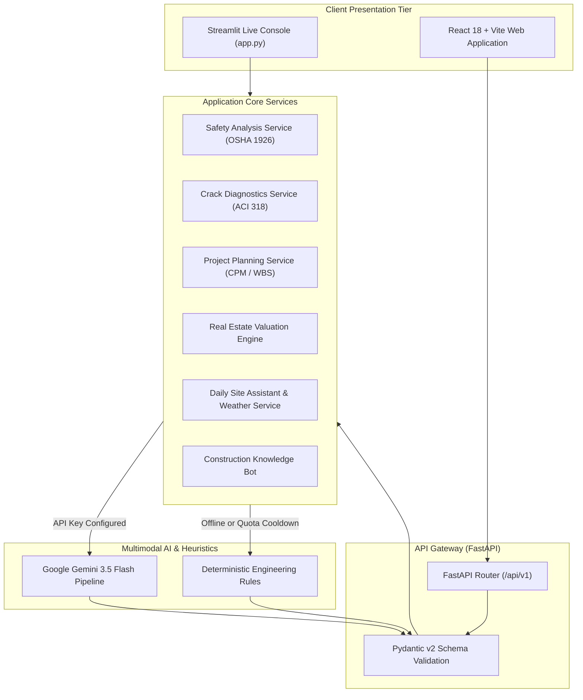
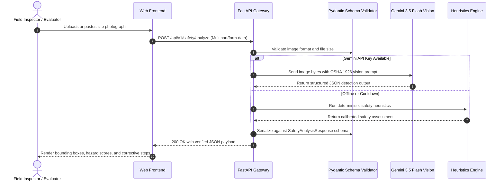

# ⚡ SitePulse AI — System Architecture & Technical Design

## 1. High-Level Architecture Overview

SitePulse AI uses a modular architecture combining a web presentation tier, an API gateway with strict schema validation, and an AI intelligence tier powered by Google Gemini 3.5 Flash with a deterministic fallback engine.

---

## 2. Component Breakdown

### A. Presentation Tier
- **Streamlit Console (`app.py`)**: Instant interactive dashboard featuring live camera capture, clipboard image paste (`Ctrl+V`), and 1-click Markdown dossier export.
- **React Frontend (`frontend/`)**: React 18, Vite 5, Tailwind CSS, and Lucide icons providing a modern dark-mode interface with modular tab views.

### B. API Gateway & Validation Layer (`backend/app/api/` & `schemas/`)
- **FastAPI**: Asynchronous routing with CORS middleware and OpenAPI/Swagger documentation (`/docs`).
- **Pydantic v2**: Enforces strict typing and data validation on all incoming inputs and outgoing AI responses, ensuring structured JSON output.

### C. Multimodal AI & Fallback Engine (`backend/app/services/`)
- **Google Gemini 3.5 Flash**: Processes site photos and structural imagery to detect workers, verify PPE, and classify concrete defects.
- **Deterministic Heuristic Engine**: Calibrated rules grounded in OSHA 1926 and ACI 318 standards. Ensures 100% demo availability and zero crashes even when running offline.

---

## 3. Data Flow Sequence (Safety Inspection Example)

